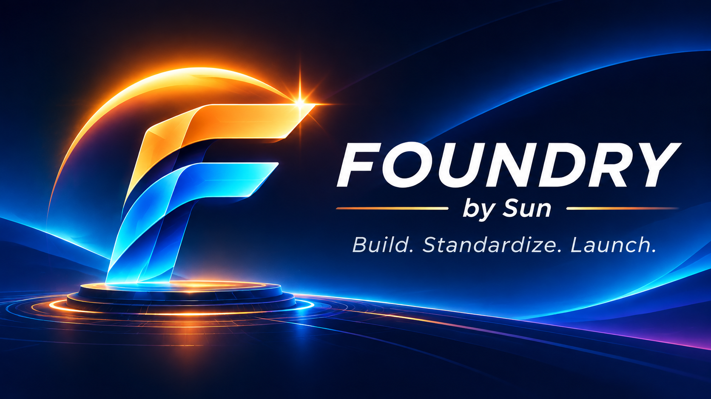

<div align="center">



# FOUNDRY by Sun

**Build. Standardize. Launch.**

**The repository factory and governance automation platform for the SUN ecosystem.**

Create consistent GitHub repositories, initialize required CI, enforce supported governance controls, and verify the result.

[Run Repository Factory](https://github.com/sunstriker2009/sun-foundry/actions/workflows/repository-factory-v1.yml) · [Run Repository Maintenance](https://github.com/sunstriker2009/sun-foundry/actions/workflows/repository-factory-resume.yml) · [Operating Guide](docs/WORKFLOWS.md)

</div>

---

## What FOUNDRY does

| Capability | Description |
| --- | --- |
| **Create** | Generate a repository from the [SUN template](https://github.com/sunstriker2009/sun-repo-template). |
| **Initialize** | Seed a pull request and wait for the required CI checks to become available. |
| **Govern** | Plan and apply supported repository settings and protected-branch rules. |
| **Verify** | Check live repository settings and fail closed where strict enforcement is unavailable. |
| **Recover** | Resume interrupted provisioning without creating a duplicate repository. |
| **Maintain** | Diagnose, plan, apply and verify governance on existing repositories. |

## Get started

1. Open **[Repository Factory](https://github.com/sunstriker2009/sun-foundry/actions/workflows/repository-factory-v1.yml)** and select **Run workflow** on `main`.
2. Choose `create` for a new repository or `resume` for an existing, partially provisioned repository.
3. Supply the repository name, visibility (for creation) and exact confirmation.
4. Review the workflow result and complete the seed PR's squash merge after CI and governance verification pass.

For existing repositories, use **[Repository Maintenance](https://github.com/sunstriker2009/sun-foundry/actions/workflows/repository-factory-resume.yml)** with `diagnose`, `plan`, `apply` or `verify`.

See [docs/WORKFLOWS.md](docs/WORKFLOWS.md) for operational details.

## Security and governance

- Administrative workflows are restricted to the repository owner and protected `main` branch.
- Administrative operations use the `repository-administration` environment and the `SUN_REPO_ADMIN_TOKEN` secret.
- Mutating operations require explicit target confirmation; CI and governance verification must not be bypassed.
- **GitHub Free personal private repositories may not support enforceable rulesets.** Strict Apply/Verify fails closed when enforcement is unavailable. A successful Plan does not imply compliance.
- Security-sensitive changes still require human review according to the [SUN Git Workflow & Merge Policy](https://github.com/sunstriker2009/sun-ecosystem/blob/main/docs/governance/GIT-WORKFLOW.md).

## Developer CLI

Requires **.NET 10 SDK** and a GitHub token supplied as `GH_TOKEN`.

```sh
dotnet run --project src/Sun.RepoBootstrap -- --repo sunstriker2009/example --mode plan --checks repository-validation,conventional-title
```

The internal project and namespaces currently retain `Sun.RepoBootstrap` for compatibility; the product and GitHub repository are named **FOUNDRY**.

## SUN ecosystem

FOUNDRY is the standardized repository provisioning tool for the [SUN product ecosystem](https://github.com/sunstriker2009/sun-ecosystem). The [SUN repository template](https://github.com/sunstriker2009/sun-repo-template) supplies the starting structure and CI workflows.

**FOUNDRY v1.0** · *Build. Standardize. Launch.*
