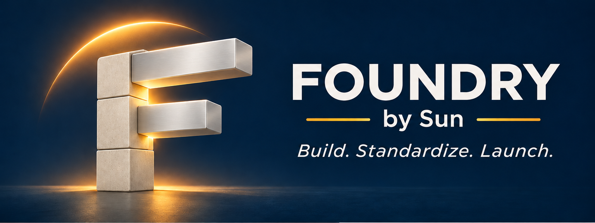

<div align="center">



# FOUNDRY by Sun

**Build. Standardize. Launch.**

**The repository factory and governance automation platform for the SUN ecosystem.**

Create consistent GitHub repositories, initialize required CI, enforce supported governance controls, and verify the result.

[Run Repository Factory](https://github.com/sunstriker2009/sun-foundry/actions/workflows/repository-factory-v1.yml) · [Run Repository Maintenance](https://github.com/sunstriker2009/sun-foundry/actions/workflows/repository-factory-resume.yml) · [Operating Guide](docs/WORKFLOWS.md)

</div>

---

## What FOUNDRY does

| Capability | Description |
| --- | --- |
| **Create** | Generate a repository from the [STRATA template](https://github.com/sunstriker2009/sun-strata). |
| **Initialize** | Seed a pull request and wait for the required CI checks to become available. |
| **Govern** | Plan and apply supported repository settings and protected-branch rules. |
| **Verify** | Check live repository settings and fail closed where strict enforcement is unavailable. |
| **Recover** | Resume interrupted provisioning without creating a duplicate repository. |
| **Maintain** | Diagnose, plan, apply and verify governance on existing repositories. |
| **Audit** | Report strict governance compliance and drift across an explicit repository allowlist without changing settings. |
| **Install branding** | Validate an uploaded branding ZIP, create numbered asset revisions and propose installation or rollback through a PR. |
| **Align** | Plan and apply reviewed changes to an explicitly identified existing ruleset, then verify the result. |

## Get started

1. Open **[Repository Factory](https://github.com/sunstriker2009/sun-foundry/actions/workflows/repository-factory-v1.yml)** and select **Run workflow** on `main`.
2. Choose `create` for a new repository or `resume` for an existing, partially provisioned repository.
3. Supply the repository name, visibility (for creation) and exact confirmation.
4. Review the workflow result and complete the seed PR's squash merge after CI and governance verification pass.

For existing repositories, use **[Repository Maintenance](https://github.com/sunstriker2009/sun-foundry/actions/workflows/repository-factory-resume.yml)** with `diagnose`, `plan`, `apply` or `verify`.

See [docs/WORKFLOWS.md](docs/WORKFLOWS.md) for operational details and [repository selection](docs/WORKFLOW-INPUTS.md) for short-name dropdowns and confirmations.

## Product registration lifecycle checklist (draft)

See the [draft design](docs/PRODUCT-REGISTRATION-LIFECYCLE.md) for the workflow and open decisions.

- [x] Define the [naming and slug rules, family mappings, and description defaults](docs/PRODUCT-REGISTRATION-LIFECYCLE.md#registration-rules).
- [ ] Seed Foundry's catalog from existing registrations, preserving assigned IDs and the next ID in each family.
- [ ] Add a registration workflow that derives the ID and repository slug, validates availability, and opens a Foundry PR for manual owner approval.
- [ ] Validate the proposed ID against current `main` before merge and require renewed review if the ID changes.
- [ ] Provision from the approved merge. Include `branding/manifest.json` and the revision directory marker in the seed PR, and auto-merge after CI and strict governance verification pass.
- [ ] Verify the manifest on the product repository's `main`, then publish metadata and regenerate references through an Ecosystem PR that auto-merges after its required checks pass.
- [ ] Verify retry behavior after partial failures, confirm how environment approval works, and test the full lifecycle before switching from the existing registration workflow.

## Branding ZIP installer

On an opted-in repository’s feature branch, commit a package to `branding/revisions/`; the push hook installs it in a follow-up commit on that branch. A manual fallback remains available through [Branding ZIP Installer](https://github.com/sunstriker2009/sun-foundry/actions/workflows/branding-zip-install.yml). In the fallback, Preview validates without writing; Apply proposes a reviewed PR with `branding/revisions/v1.zip` as the initial backup and `v2.zip` onward as complete asset snapshots. See the [installation and rollback guide](docs/BRANDING-ZIP-INSTALLER.md).

## Shared asset preparation (v1)

FOUNDRY includes a [validated local-first SUN asset-preparation tool](docs/ASSET-PIPELINE.md) for approved PNG artwork. It prepares proportional README banners, icon sizes, favicon, optional transparent symbol exports and a SHA-256 manifest in a separate generated directory. It does not invent artwork or overwrite approved production assets. A narrowly path-filtered CI smoke test covers the tool; the first pilot ran on FOUNDRY itself. See the [opt-in adoption guide](docs/ASSET-ADOPTION.md) for new SUN products; OUTPOST and WORKBENCH are not modified.

Repository Factory v1 completed a controlled public-repository live test in November 2026, including repeat resume after an idempotency fix, strict governance verification, squash-merge integration, and disposable repository cleanup. See the [validation record and remaining boundaries](docs/WORKFLOWS.md#factory-v1-live-validation--november-2026).

## Security and governance

- Administrative workflows are restricted to the repository owner and protected `main` branch.
- Administrative operations use the `repository-administration` environment and the `SUN_REPO_ADMIN_TOKEN` secret.
- Mutating operations require explicit target confirmation; CI and governance verification must not be bypassed.
- **GitHub Free personal private repositories may not support enforceable rulesets.** Strict Apply/Verify fails closed when enforcement is unavailable. A successful Plan does not imply compliance.
- Security-sensitive changes still require human review according to the [SUN Git Workflow & Merge Policy](https://github.com/sunstriker2009/sun-ecosystem/blob/main/docs/governance/GIT-WORKFLOW.md).

## Developer CLI

Requires **.NET 10 SDK** and a GitHub token supplied as `GH_TOKEN`.

```sh
dotnet run --project src/Sun.RepoBootstrap -- --repo sunstriker2009/example --mode plan --checks repository-validation,conventional-title
```

The internal project and namespaces currently retain `Sun.RepoBootstrap` for compatibility; the product and GitHub repository are named **FOUNDRY**.

## SUN ecosystem

FOUNDRY is the standardized repository provisioning tool for the [SUN product ecosystem](https://github.com/sunstriker2009/sun-ecosystem). The [STRATA by Sun](https://github.com/sunstriker2009/sun-strata) supplies the starting structure and CI workflows.

**FOUNDRY v1.0** · *Build. Standardize. Launch.*

## Milestones and fleet audit

See the [FOUNDRY roadmap](docs/ROADMAP.md) for implemented milestones and outstanding validation gates. The operator reported the final five-repository audit successful; this is not a continuously refreshed compliance claim. Repeat the [manual governance fleet audit](docs/GOVERNANCE-FLEET-AUDIT.md), using the existing `repository-administration` environment and `SUN_REPO_ADMIN_TOKEN`. It produces per-repository results and JSON evidence; it does not remediate findings or run on a schedule.

Use [Controlled Governance Alignment](docs/GOVERNANCE-ALIGNMENT.md) to address reviewed audit findings through manual Plan → Apply → Verify, using the existing protected administration environment.

## Resuming governance work

Read the [governance handoff](docs/GOVERNANCE-HANDOFF.md) for verified evidence, pending validation, cross-repository responsibilities and resume boundaries before continuing after thread archival.
