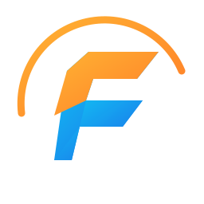
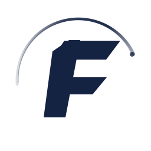
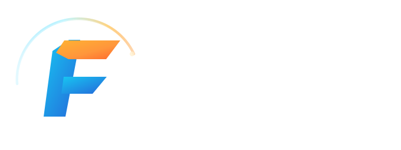
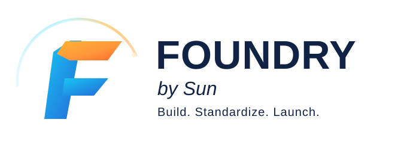
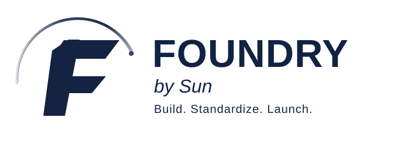
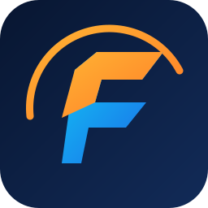

# FOUNDRY Compact Asset Review

**Status:** Revision 2 for owner review — floating disconnected F arms and a thin glass-like SUN arc, based on the approved Foundry F second treatment.

The production panoramic banner remains unchanged: [README banner](../assets/readme-banner-v1.png). These compact assets are designed to be legible in application headers, docs and icons, rather than reproduce the cinematic effects of the banner.

## Revision 2 design notes

- The vertical stem, upper arm and middle arm are **separate paths**, with intentional negative-space gaps.
- The SUN arc is a fine translucent gradient with a subtle secondary highlight, rather than a heavy solid band.
- At very small sizes the arc is slightly strengthened for visibility; the panoramic banner is unchanged.
- The compact SVGs remain **proposals pending owner visual approval**, not final production assets.

## Symbol variants

| Dark surface | Light surface | Monochrome | Small-size |
| --- | --- | --- | --- |
|  |  |  |  |

## Full lockups

## App icon master

The SVG app icon is the vector master. Raster exports (16, 32, 64, 128, 256, 512 px), transparent/background choices, favicon and platform packaging should be generated after visual approval.

## Review criteria

- [ ] Confirm symbol matches the approved Foundry F direction sufficiently.
- [ ] Check light/dark contrast and monochrome legibility.
- [ ] Check small-size legibility at 16, 24 and 32 px.
- [ ] Confirm lockup typography and spacing.
- [ ] Approve palette values and typography or request adjustments.
- [ ] Produce and commit raster exports after approval.

Do not mark compact assets final until review and app-icon export are complete.
