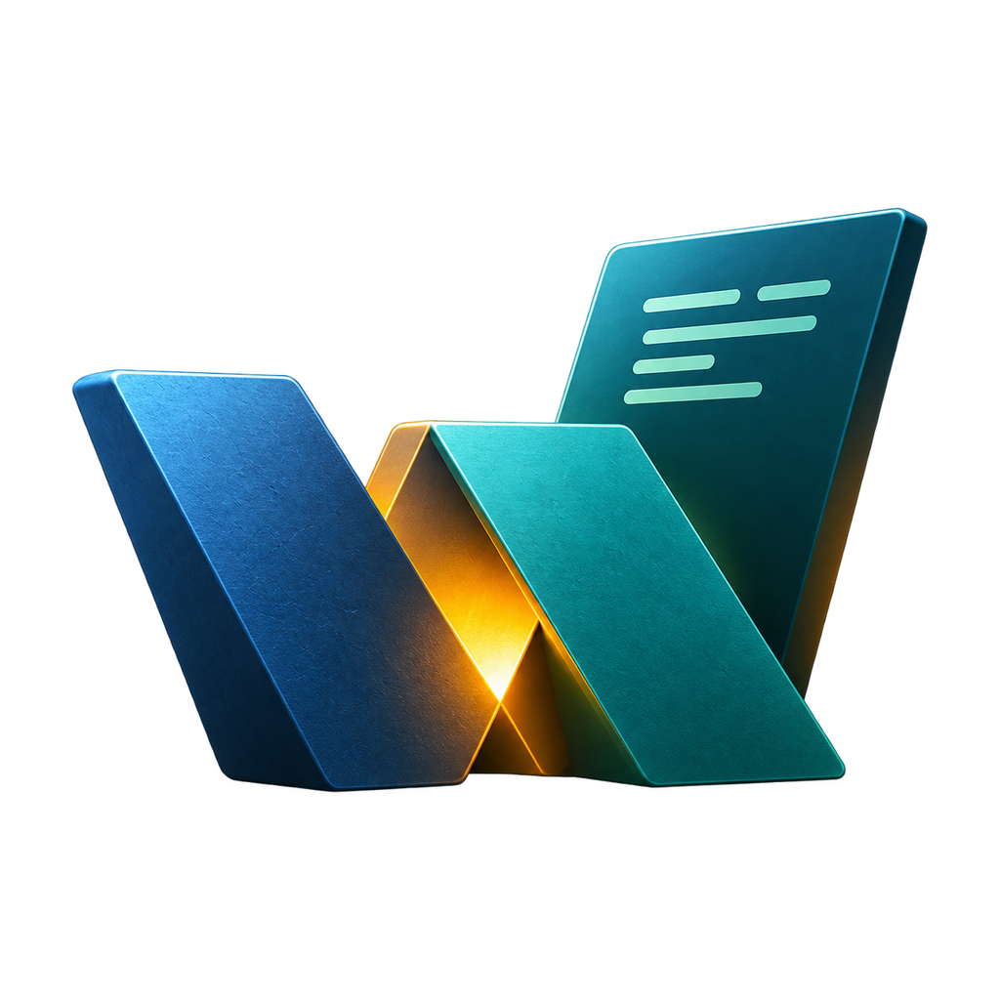
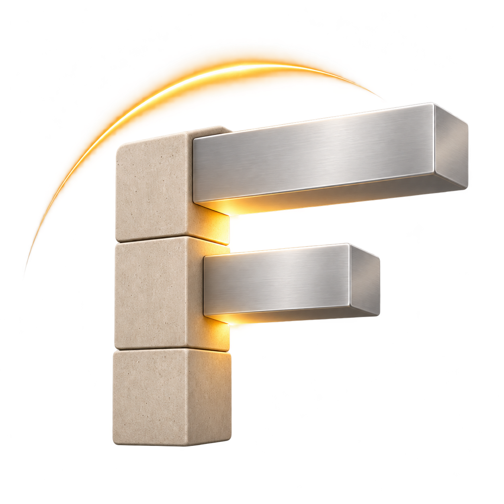
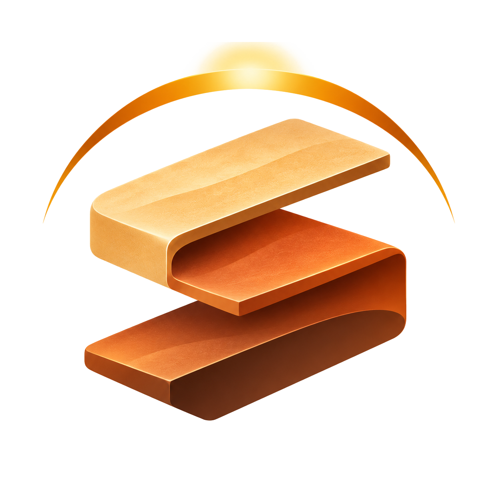

<!-- SUN-REPOSITORY-GALLERY:START -->
# SUN Repository Gallery

Generated from [the repository catalog](repositories.json). Approved identities remain governed by [products.json](products.json).

## Products

<table>
<tr>
<td align="center" width="180"><a href="https://github.com/sunstriker2009/sun-codefolio"><strong>CodeFolio</strong></a>
<strong>CodeFolio</strong>
<small>SUN-P002 · code management</small></td>
<td align="center" width="180">
<strong>Outpost</strong>
<small>SUN-C001 · Identity, authentication, authorization and security</small></td>
<td align="center" width="180">
<strong>Workbench</strong>
<small>SUN-P001 · Local code organizer and interactive scripting workspace</small></td>
</tr>
</table>

## Infrastructure

<table>
<tr>
<td align="center" width="180">
<strong>Foundry</strong>
<small>SUN-G003 · Repository factory and governance verification</small></td>
<td align="center" width="180"><a href="https://github.com/sunstriker2009/sun-foundry-pilot"><strong>Foundry Pilot</strong></a>
<strong>Foundry Pilot</strong>
<small>SUN-G004 · Isolated repository for validating Foundry provisioning and inherited branding</small></td>
<td align="center" width="180">
<strong>Strata</strong>
<small>SUN-G002 · Reusable repository template</small></td>
</tr>
</table>
<!-- SUN-REPOSITORY-GALLERY:END -->
